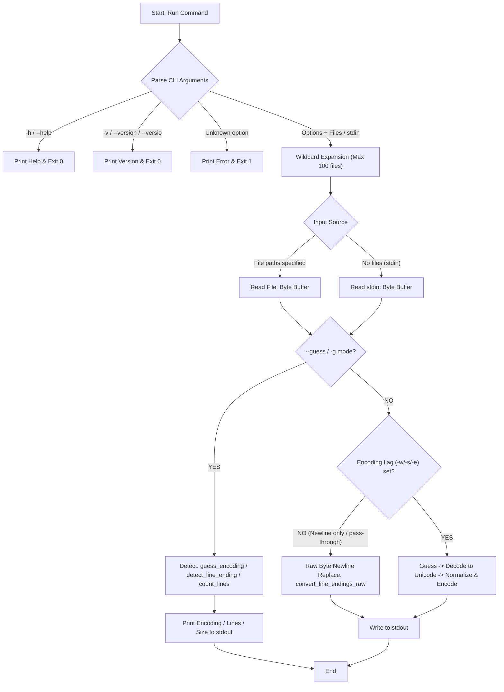
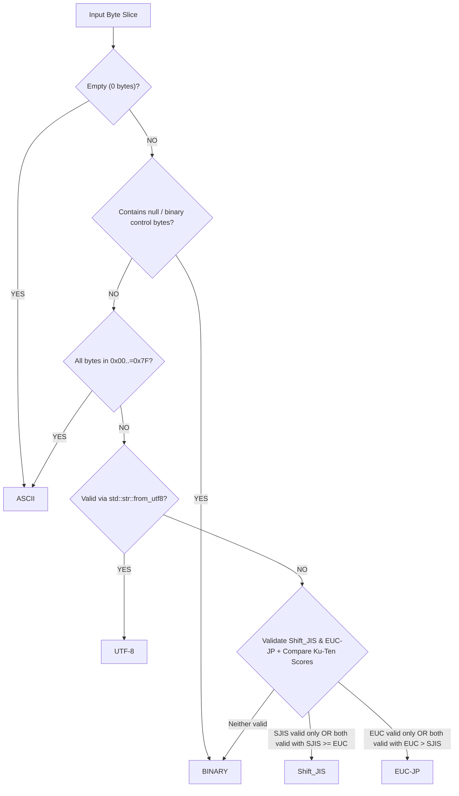

**English** | [日本語版](../ja/DIAGRAM.md)

# System Diagram (DIAGRAM.md)

This document visualizes the execution pipeline and encoding auto-detection flow of the `MyNKF` CLI utility using Mermaid diagrams.

---

## 1. Overall Data Flow (CLI Utility)

The end-to-end pipeline from CLI argument parsing through glob expansion, input reading, encoding detection or conversion, and standard output.

---

## 2. Encoding Auto-Detection Algorithm (Guess Flow)

The heuristic process identifying encodings through control-byte checks, strict UTF-8 validation, and JIS X 0208 Ku-Ten scoring.

