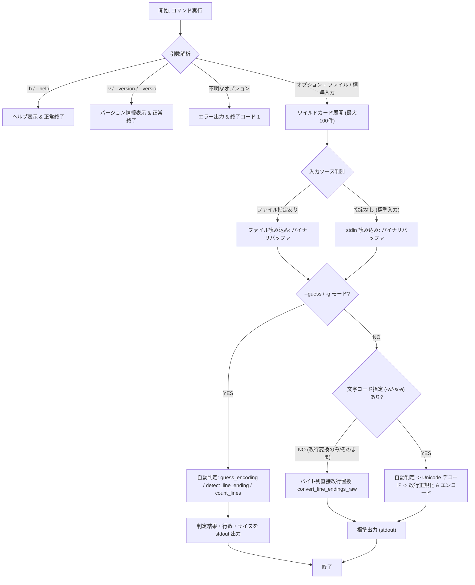
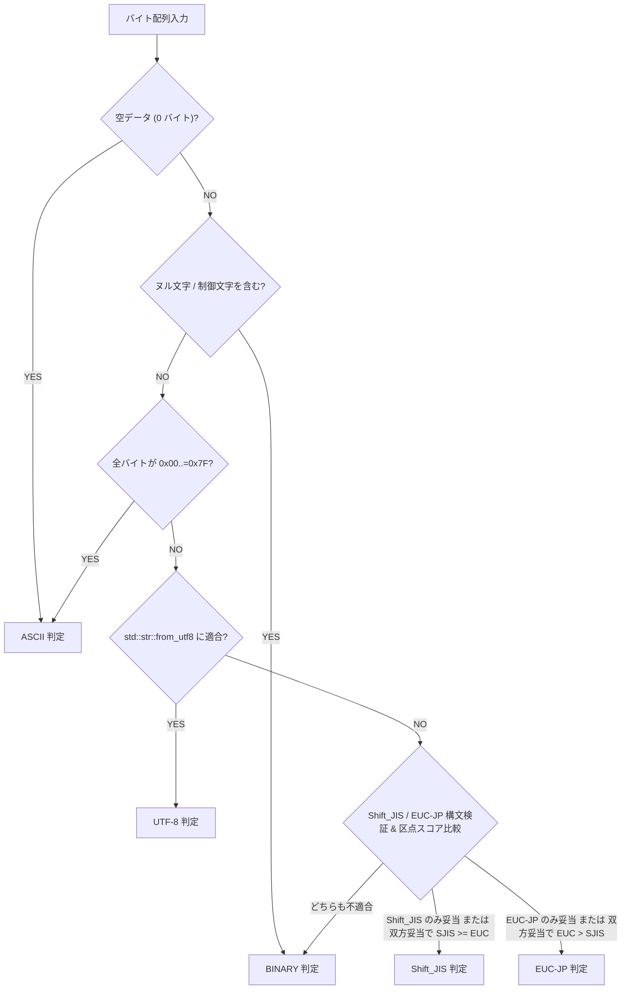

[English](../en/DIAGRAM.md) | **日本語版**

# システム構成図 (DIAGRAM.md)

本ドキュメントでは、`MyNKF` CLI ユーティリティの処理パイプラインおよび文字コード自動判定フローを Mermaid ダイアグラムで表現します。

---

## 1. 全体データフロー (CLI ユーティリティ)

CLI コマンドが実行された際の、引数解析から入力取得、自動判定または文字コード・改行コード変換、標準出力までの処理パイプラインです。

---

## 2. 文字コード自動判定アルゴリズム (Guess Flow)

バイトシーケンスの制御文字チェック、厳格な UTF-8 検証、および JIS X 0208 区点スコアリングによりエンコーディングを特定する処理フローです。

